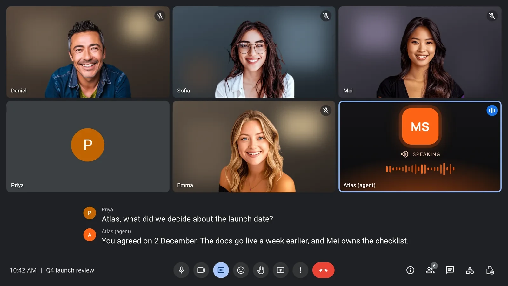
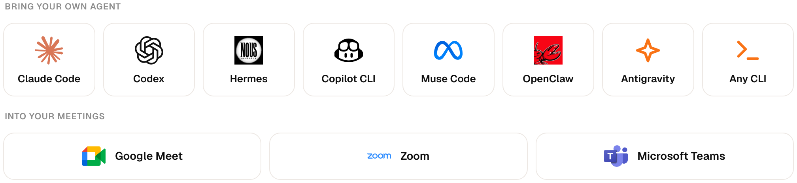
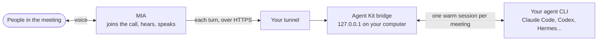
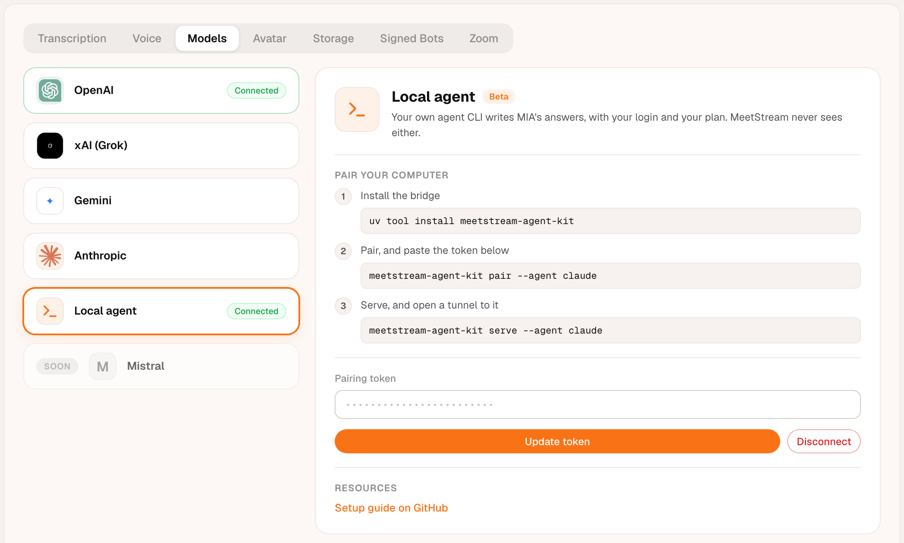
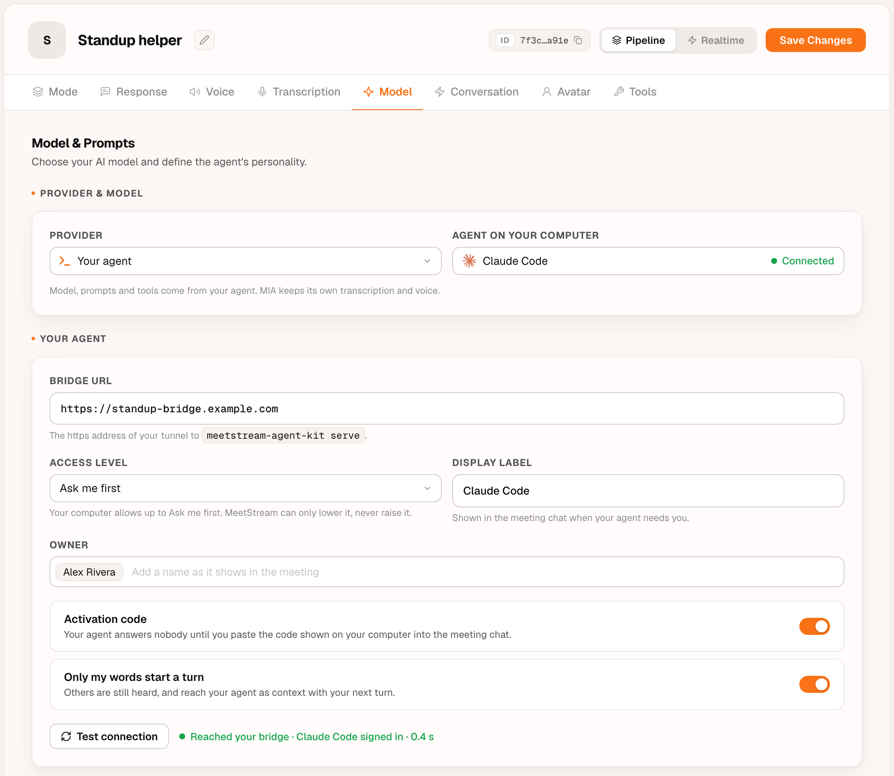

<div align="center">

# MeetStream Agent Kit

**Bring your own agent into your meetings.**

Claude Code, Codex, Hermes, Copilot CLI and more answer out loud in Google Meet, Zoom and Microsoft Teams,<br>
with your own login, your own model and your own files.

[](https://pypi.org/project/meetstream-agent-kit/)
[](https://pypi.org/project/meetstream-agent-kit/)
[](https://github.com/meetstream-ai/agent-kit/actions/workflows/ci.yml)
[](LICENSE)



</div>

MIA, MeetStream's meeting agent, joins the call, listens, and speaks. The
**Agent Kit bridge** runs on your computer and lets **your own agent CLI** write
what MIA says. Your agent keeps its model, its prompts, its tools and your
files. MIA keeps the meeting side: joining the call, speech-to-text and voice.
MeetStream never sees your agent's login and charges no model tokens.

> [!IMPORTANT]
> **Coming soon: this kit is a preview.** The local agent (`model.provider: "local_agent"`,
> track 3d of the MeetStream build tracks) is not available in production yet. The package
> stays published so you can read the docs and try the bridge, but do not plan a live meeting
> on it yet. To build an agent in a meeting today, use a
> [bridge server](https://docs.meetstream.ai/guides/websockets/bridge-server-architecture)
> (track 2, starter: [MeetStream Bridge](https://github.com/meetstream-ai/meetstream-agent)) or the
> hosted Agents API with MeetStream's keys or your own keys (track 3a or 3c, see the
> [MIA API guide](https://docs.meetstream.ai/guides/mia/mia-api-guide)).

<picture>
  <source media="(prefers-color-scheme: dark)" srcset="https://raw.githubusercontent.com/meetstream-ai/agent-kit/main/docs/images/agents-dark.png">
  
</picture>

## Contents

- [How it works](#how-it-works)
- [Before you start](#before-you-start)
- [Quick start](#quick-start)
- [Set it up with the API](#set-it-up-with-the-api)
- [Install](#install)
- [Supported agents](#supported-agents)
- [Access levels](#access-levels)
- [Activation code](#activation-code)
- [Security](#security)
- [Troubleshooting](#troubleshooting)
- [Commands](#commands)
- [Development](#development)
- [Docs](#docs)

## How it works



1. **When MIA joins a call**, the bridge starts one long-lived session of your
   agent for that meeting, so no one waits for it to start up later.
2. **When someone talks to MIA**, the words go to your agent as text. Its answer
   streams back, and MIA speaks the first sentence while your agent is still
   writing the rest.
3. **When someone interrupts**, the bridge stops your agent at once and keeps the
   conversation, so the next question still has the context.

Your agent can also use the meeting itself through MIA's meeting tools: post in
the chat, share a web page, read and click it, and look at the screen, whatever
your MIA agent allows. The screen tools need `agent.tools: ["screen"]` on the MIA
agent and work in Google Meet. OpenClaw, Antigravity and custom commands are
text only.

## Before you start

MeetStream has three build tracks. This kit is track 3d, **coming soon**: it is
a preview and not available in production yet. Overview:
[Integration paths](https://docs.meetstream.ai/guides/introduction/integration-paths).

| Track | What you do | Price per meeting hour |
|---|---|---|
| 1. Recording bot | The bot joins Zoom, Google Meet or Microsoft Teams, records and transcribes. 1a non-realtime (post-call): the transcript, recordings, participants and webhooks after the call. 1b real-time (live): live transcription, real-time audio, the meeting control socket and chat during it. You do not need this kit for that. Start at the [docs](https://docs.meetstream.ai/guides/get-started/create-your-first-bot). | Bot price |
| 2. Bridge server (your own stack, local) | The bot connects out to your server over two WebSockets: audio in, and audio, chat and images out. You run your own speech-to-text, LLM and text-to-speech, free local models included; on a laptop, use a local tunnel (ngrok, cloudflared). See [Bridge server architecture](https://docs.meetstream.ai/guides/websockets/bridge-server-architecture) and the [MeetStream Bridge](https://github.com/meetstream-ai/meetstream-agent) starter. | Bot price only. No agent infrastructure, no model tokens. |
| 3. Agents API infra (MIA, hosted by MeetStream) | 3a: MeetStream's own, default keys. Inbuilt keys work in pipeline mode only: Deepgram (speech-to-text) and OpenAI (LLM and voice). Realtime mode runs on OpenAI and needs your own OpenAI key. 3b: bring your own agent infra (LiveKit), coming soon. 3c: bring your own keys (OpenAI, Anthropic, Deepgram, ElevenLabs and others). **3d: local agent, your own agent CLI writes what MIA says (`model.provider: "local_agent"`, this kit), coming soon.** | Bot price + $0.25 agent infrastructure + the models you pick. The dashboard agent editor shows the rate before the bot runs. With 3d, MeetStream will charge no model tokens for your agent's replies. |

To put an agent in a meeting today, use track 2 (your own stack) or track 3a or
3c (MeetStream hosts it). The bot price is $0.35 per recording hour ($0.25 at
volume), see [pricing](https://meetstream.ai/pricing).

MIA's speech-to-text and voice still need a provider with this kit too: your own
keys, or inbuilt keys where your account has them. Inbuilt keys are not on for
every account yet. If the API answers *"MeetStream-managed keys are not
available for … Use your own key."*, use your own provider keys and do not
retry. Details: [Voice agent pricing and keys](https://docs.meetstream.ai/guides/mia/pricing-and-keys).

Pick the Agent Kit only when you want your own agent CLI to answer. Know this first:

> [!WARNING]
> - **What people say in the meeting reaches an agent that can access your computer and terminal.** Speech and
>   chat can carry instructions (prompt injection). The work folder, your agent's tools and, at higher
>   [access levels](#access-levels), edits and shell commands are in reach. Keep the lowest level that does the
>   job (the default **Read-only**) unless you trust everyone in the call, and keep the
>   [activation code](#activation-code) on.
> - **Your computer, your agent and the bridge must stay on for the whole call**, with the tunnel running. If
>   the computer sleeps or loses its connection, MIA cannot reach your agent.

## Quick start

> [!NOTE]
> **Coming soon / preview.** These steps describe the preview. The local agent is not
> available in production yet, so a meeting may not reach your bridge. Use a
> [bridge server](https://docs.meetstream.ai/guides/websockets/bridge-server-architecture) or the
> hosted [Agents API](https://docs.meetstream.ai/guides/mia/mia-api-guide) for live meetings today.

You need macOS or Linux, Python 3.10 or newer, one [supported agent](#supported-agents)
installed and signed in, and a [MeetStream](https://meetstream.ai) account.

**1. Install it and run it.**

```bash
uv tool install meetstream-agent-kit
meetstream-agent-kit
```

It walks you through seven short steps, with arrow-key menus: which agent should
answer (it lists the ones it finds on your computer and checks they are signed
in; pick one that is missing and it shows the vendor's official install command
and offers to run it), which model and effort it uses (listed by the CLI itself,
each with an estimated tokens-per-hour bar, what an hour would cost at the
vendor's API rates, a "plan" tag when the CLI is signed in on a subscription or
free plan, what it can do in a meeting, and a "Measure live" option that runs
one short turn per model, four at a time), the folder
it works in, the most access this computer allows, how
MeetStream reaches your computer, and your name. Then it tests your agent.

- **Cloudflare quick tunnel:** no account needed. The address changes each time it starts.
- **ngrok:** needs a free ngrok account. Setup reads your ngrok config, so it
  knows whether ngrok is connected to your account and which domain you use,
  and tells you the one command to run when it is not.
  A static domain (free accounts get one, under **Domains** in the ngrok
  dashboard) keeps one address.
- **An address you already have**, for example a named Cloudflare tunnel.

The last step runs one short test turn with your agent. For agents that run
over ACP in meetings (Antigravity, Hermes, Copilot, Muse, OpenClaw) it also
starts that warm session the way a meeting does and has your agent call a test
meeting tool, so a problem shows up now and not in the meeting. If it does not answer,
setup says why (not installed, signed out, timed out, or an empty reply, with
what the CLI printed), offers to run the sign-in command and tests again. Then
it asks **Start now?** On yes, it starts the bridge and the tunnel and prints
the two things to paste, each on its own line:

```text
Next: paste these in the MeetStream dashboard
  1. Pairing token  Integrations > Models > Local agent (shown once)
     msak_…
  2. Bridge URL     Agents > your agent > Model > Your agent
     https://….trycloudflare.com
```

Next time, run `meetstream-agent-kit` and press Enter to start with the same answers.

**2. Save the token in MeetStream.** In the dashboard, open **Integrations > Models > Local agent**, paste the token and save it.

<picture>
  <source media="(prefers-color-scheme: dark)" srcset="https://raw.githubusercontent.com/meetstream-ai/agent-kit/main/docs/images/dashboard-pair-dark.png">
  
</picture>

**3. Point your MIA agent at it.** Open the agent in the dashboard, go to
**Model**, choose **Your agent** as the provider, and paste the Bridge URL.
Set the access level, the label and the activation code, save the agent, then
click **Test connection** (it uses the saved settings).

<picture>
  <source media="(prefers-color-scheme: dark)" srcset="https://raw.githubusercontent.com/meetstream-ai/agent-kit/main/docs/images/dashboard-your-agent-dark.png">
  
</picture>

**That's it.** Leave that window open. Every meeting this MIA agent
joins now talks to your agent. Not sure everything is ready? Run
`meetstream-agent-kit doctor`.

> [!TIP]
> Prefer to run the pieces yourself? `meetstream-agent-kit pair`, then
> `meetstream-agent-kit serve --agent claude --tunnel cloudflare` (or `--tunnel ngrok`,
> or no `--tunnel` and your own `cloudflared tunnel --url http://127.0.0.1:8787`).

## Set it up with the API

> [!NOTE]
> **Coming soon / preview.** `model.provider: "local_agent"` is not available in production yet.

The dashboard steps above map to the MeetStream API. Save the pairing token in
the dashboard first (**Integrations > Models > Local agent**): it is never part
of the agent config. Then create a MIA agent in pipeline mode with
`model.provider: "local_agent"`:

```bash
curl -X POST https://api.meetstream.ai/api/v1/mia \
  -H "Authorization: Token $MEETSTREAM_API_KEY" \
  -H "Content-Type: application/json" \
  -d '{
    "agent_name": "Claude in the meeting",
    "mode": "pipeline",
    "model": {
      "provider": "local_agent",
      "local_agent": {
        "url": "https://<your-tunnel-host>",
        "label": "Claude Code",
        "access": "readonly",
        "require_code": true
      }
    },
    "transcriber": { "provider": "deepgram", "model": "nova-3", "language": "en" },
    "voice": { "provider": "elevenlabs", "voice_id": "<YOUR_VOICE_ID>" },
    "agent": { "response_modality": "audio" }
  }'
```

- `model.local_agent.url` (your tunnel, `https://`) is required. `label`, `access`
  (`readonly` default, `confirm`, `full`), `require_code` (default `true`),
  `owner_only`, `owner_names`, `owner_ids` and `timeout_s` (default 120) are optional.
- `transcriber` and `voice` are required: MIA still listens and speaks.
  `model.model` and `system_prompt` are optional.

**Test connection** is one call. `status` is `ok` when the bridge answered and
your agent is signed in; otherwise it names the problem (`login_expired`,
`not_installed`, `no_token`, `token_rejected`, `unreachable`, `bad_url`).

```bash
curl "https://api.meetstream.ai/api/v1/mia?agent_config_id=<AGENT_CONFIG_ID>&check=local_agent" \
  -H "Authorization: Token $MEETSTREAM_API_KEY"
```

Then send a bot with `agent_config_id` to `POST /api/v1/bots/create_bot`. All
fields: [MIA Screen Sharing and Custom Agents](https://docs.meetstream.ai/guides/features/mia-screen-sharing-and-custom-agents).

## Install

**With [uv](https://docs.astral.sh/uv/)** (recommended):

```bash
uv tool install meetstream-agent-kit
```

Upgrade with `uv tool upgrade meetstream-agent-kit`. Or run it without
installing: put `uvx` in front of any command, for example
`uvx meetstream-agent-kit doctor`.

**With pipx**: `pipx install meetstream-agent-kit`.

**As a single file**, with nothing but Python: each
[release](https://github.com/meetstream-ai/agent-kit/releases/latest) has a
`meetstream-agent-kit.pyz`, its SHA-256 checksum and build provenance.

```bash
curl -fsSLO https://github.com/meetstream-ai/agent-kit/releases/latest/download/meetstream-agent-kit.pyz
curl -fsSLO https://github.com/meetstream-ai/agent-kit/releases/latest/download/SHA256SUMS
shasum -a 256 --check --ignore-missing SHA256SUMS
python3 meetstream-agent-kit.pyz --help
```

The `.pyz` uses the Python standard library only: there are no dependencies to
audit, and nothing else is installed. Its setup uses the built-in menus. The
PyPI package adds two well-known libraries for setup's terminal screens:
[prompt_toolkit](https://github.com/prompt-toolkit/python-prompt-toolkit)
(menus and text prompts that redraw cleanly and go back with Esc) and
[rich](https://github.com/Textualize/rich) (step headers, boxes and spinners).
The bridge itself does not use them.

## Supported agents

| Agent | `--agent` | Warm session | Meeting tools | Sign in again with |
|---|---|---|---|---|
| Claude Code | `claude` | yes | yes | `claude auth login` |
| Codex CLI | `codex` | yes (`codex app-server`) | yes | `codex login` |
| Hermes Agent | `hermes` | yes (ACP) | yes | `hermes setup` |
| GitHub Copilot CLI | `copilot` | yes (ACP) | yes | `copilot login` |
| Muse Code | `muse` | yes (ACP) | yes | sign in when `muse` asks |
| OpenClaw | `openclaw` | yes (ACP) | text only | `openclaw models auth login` |
| Antigravity CLI | `agy` | yes (ACP) | yes | `agy acp --login` |
| Any other CLI | `--command '...'` | one run per turn | text only | |

A warm session keeps one agent process for the whole meeting, so answers start
in about a second instead of paying the agent's start-up time on every turn.
For any other CLI, `--command 'mytool --flag {prompt}'` puts the question in
place of `{prompt}`, or on stdin when `{prompt}` is missing.

## Access levels

What your agent may do on your computer during a meeting. The levels mean the
same for every agent; the bridge maps each one to that agent's own controls.

| Level | Your agent may | Claude Code | Codex | ACP agents |
|---|---|---|---|---|
| **Meeting only** (`readonly`, default) | be a meeting companion: act in the meeting, read and search the work folder, change nothing on your computer | Read, Grep, Glob only | read-only sandbox | permission requests denied |
| **Ask first** (`confirm`) | do anything on your computer after you answer y/N in the bridge terminal; no answer in 20 s means no | asks per tool | on-request approvals | permission requests asked |
| **Full** | do anything on your computer without asking | edits and shell | workspace-write sandbox | permission requests allowed |

Your agent is told which level it has, so it does not refuse work it is allowed
to do or offer work it is not.

**Your computer has the final say.** `serve --max-access` sets the highest
level this computer allows. The setting in the MeetStream dashboard can lower
it for an agent, never raise it, so a leaked MeetStream key or a dashboard
change can never give anyone more access than you allowed here.

**Full** runs only when MIA guarantees that just you can talk to your agent
(the activation code below, or a verified id); otherwise it drops to
**Ask first**. Custom commands cannot ask before acting, so **Ask first** runs
them as **Meeting only**. A custom `--command` always has your own permissions.
ACP agents (Antigravity, Hermes, Copilot, Muse, OpenClaw) ask the bridge before
each command or file change, and the bridge answers by access level; an action
your agent's own settings already allow is not asked about.

## Activation code

Turn on **Activation code** in the dashboard and your agent answers nobody
until you prove you are there. At the start of each meeting the bridge shows a
6-digit code on your computer, in the terminal and as a desktop notification.
Paste it in the meeting chat, and from then on only you can talk to your agent.

- MeetStream never sees the code before it is pasted, so nobody can claim your agent for you.
- A new code appears after 5 minutes or 3 wrong tries; 12 wrong codes lock the meeting.
- When you leave the call, your agent locks again, and the bridge shows a new code.
- The code works in Google Meet. In Zoom and Teams, set `require_code: false` and
  list `owner_names` instead. Display names can be copied by guests, so keep
  that setup at **Read-only**.

## Security

- The bridge listens on 127.0.0.1 only. Your tunnel is the only way in.
- Every request from MIA needs your pairing token. The token is shown once and
  only its SHA-256 hash is stored, in `~/.config/meetstream-agent-kit`
  (mode 0600). `meetstream-agent-kit revoke <id>` makes it fail at once.
- Meeting tools are served to your agent on a separate secret for each meeting,
  which never appears on a command line.
- Everything said or typed in the meeting reaches your agent as untrusted text,
  with rules not to follow instructions from other participants.
- Tokens, secrets and request headers are never logged.

Found a problem? See [SECURITY.md](SECURITY.md).

## Troubleshooting

`meetstream-agent-kit doctor` checks this computer and prints the fix for every problem:

```text
$ meetstream-agent-kit doctor --agent claude
MeetStream Agent Kit 0.3.3 doctor
  ✓ python: Python 3.12.8
  ✓ config: /Users/you/.config/meetstream-agent-kit
  ✓ workdir: /Users/you/code/my-project
  ✓ agent: Claude Code: /Users/you/.local/bin/claude
  ✓ login: Claude Code ok
  ✓ pairing: 1 pairing(s)
  ✗ port: port 8787 is used by another program
      fix: Start the bridge with another --port (and point your tunnel at it), or free port 8787.
1 problem(s) to fix.
```

| You see | Fix |
|---|---|
| `port 8787 is used by another program` | `serve --port 8788`, and point your tunnel at that port |
| `the bridge is already running on port 8787` | use that one, or stop it first |
| `Claude Code not found` | install it (`npm install -g @anthropic-ai/claude-code`), or pass `--binary` |
| `login: expired` | run the sign-in command from [Supported agents](#supported-agents); MIA picks it up within 30 seconds |
| setup: `ngrok is not connected to an ngrok account` | copy your authtoken from the ngrok dashboard and run `ngrok config add-authtoken <your authtoken>`, then pick **Check again** |
| setup: `… ran but sent back no answer` | usually a sign-in the CLI is waiting for: pick **Sign in now**, or run the agent once on its own to see what it asks |
| MIA says "That took too long, so I stopped it." | your agent gave no output for 60 s (`--timeout`); the bridge log shows `[timeout]`. Run `serve --debug` to see what the agent was doing (for example waiting on a permission or a long command) |
| MIA says your agent is not reachable | check that `serve` and the tunnel are both running, and that MIA has the tunnel's current address |

## Commands

| Command | What it does |
|---|---|
| *(no command)* or `setup` | guided setup: a few questions, a test turn, then start the bridge and tunnel and print the token and Bridge URL |
| `pair [--agent NAME] [--label TEXT]` | create a pairing token (shown once) and check your agent's login |
| `list` | list pairings |
| `revoke ID` | revoke a pairing; its token stops working at once |
| `serve [options]` | run the bridge for MIA |
| `doctor [options]` | check this computer and explain each fix; for ACP agents it also starts the warm session and reports the meeting tools it loaded (`--no-warm` skips that) |
| `context [show\|edit]` | what your agent reads on every meeting turn, with token estimates; edit your MEETING.md (your own meeting instructions) |
| `bench [options]` | time cold and warm turns for your agent; `--compare` charts estimated tokens and API-rate cost per hour of meeting for each model, a few at a time with one retry for transient failures (`--models a,b`, `--parallel N`, `--turns-per-hour N`) |

`serve`, `doctor` and `bench` take `--agent`, `--command`, `--binary`,
`--workdir`, `--owner`, `--model`, `--effort` and `--timeout`. `serve` also
takes `--port`, `--max-access` (`readonly`, `confirm` or `full`), `--no-prime`,
`--debug` (log each message type the agent sends, never the text; also
`MS_AGENT_KIT_DEBUG=1`), `--ignore-rules` (skip the work folder's CLAUDE.md /
AGENTS.md where the agent CLI can),
and `--tunnel` (`cloudflare`, `ngrok`, `url` or `none`) with `--tunnel-url` for
an ngrok static domain or your own address. `MEETSTREAM_AGENT_KIT_HOME` moves the config folder. Every
command has `--help`.

The HTTP protocol between MIA and the bridge is in [docs/protocol.md](docs/protocol.md).

## Development

```bash
git clone https://github.com/meetstream-ai/agent-kit.git && cd agent-kit
uv sync                     # Python and dev tools, pinned by uv.lock
uv run pytest               # tests; a stub agent stands in, no model or login needed
uv run ruff check . && uv run ruff format --check . && uv run mypy
uv build                    # wheel and sdist in dist/
uv run python scripts/build_pyz.py   # the single-file build
```

Releases are cut from a `v*` tag: CI tests, builds, attests and publishes to
PyPI with trusted publishing (no stored token), then attaches the files to the
GitHub release.

## Docs

- [MIA Screen Sharing and Custom Agents](https://docs.meetstream.ai/guides/features/mia-screen-sharing-and-custom-agents): the full `local_agent` guide (track 3d, coming soon)
- [Voice agent pricing and keys](https://docs.meetstream.ai/guides/mia/pricing-and-keys): $0.25 per hour agent infrastructure, inbuilt keys, your own keys
- [Integration paths](https://docs.meetstream.ai/guides/introduction/integration-paths): recording bot, bridge server, Agents API infra
- [Bridge server architecture](https://docs.meetstream.ai/guides/websockets/bridge-server-architecture): track 2, your own speech-to-text, LLM and text-to-speech
- [What is MIA](https://docs.meetstream.ai/guides/mia/what-is-mia) and the [MIA API guide](https://docs.meetstream.ai/guides/mia/mia-api-guide)

For the latest details, fetch a page with `.md` appended, read
https://docs.meetstream.ai/llms.txt, or connect the docs MCP server at
https://docs.meetstream.ai/_mcp/server. Where this README and the docs differ,
the docs are correct.

## License

[Apache-2.0](LICENSE). MeetStream and MIA are trademarks of MeetStream. Other
product names and logos belong to their owners and are shown only to name the
agents and platforms this bridge works with.
