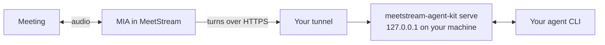

# MeetStream Agent Kit: live bridge

[](https://pypi.org/project/meetstream-agent-kit/)
[](https://pypi.org/project/meetstream-agent-kit/)
[](https://github.com/meetstream-ai/agent-kit/actions/workflows/ci.yml)
[](LICENSE)

Your own coding agent, live in your meetings.

MIA, MeetStream's meeting agent, joins your Google Meet, Zoom or Microsoft
Teams call. It hears what is said and speaks the answers. This bridge runs on
your machine and lets **your own agent CLI** write those answers, with your own
login, your own plan and your own files:

| Agent | Warm session | Meeting tools | Sign in again with |
|---|---|---|---|
| Claude Code | yes | yes | `claude auth login` |
| Codex CLI | yes (`codex app-server`) | yes | `codex login` |
| Hermes Agent | yes (ACP) | yes | `hermes setup` |
| GitHub Copilot CLI | yes (ACP) | yes | `copilot login` |
| Muse Code | yes (ACP) | yes | sign in when `muse` asks |
| OpenClaw | yes (ACP) | text only | `openclaw models auth login` |
| Antigravity CLI | yes | text only | `agy acp --login` |
| Any other command | one run per turn | text only | |

MIA keeps its own speech-to-text and voice. Your agent's model, prompts and
behaviour stay in your agent. MeetStream never sees your agent's login and pays
for no model tokens.



## Requirements

- macOS or Linux (on Windows, use WSL). Python 3.10 or newer.
- One agent CLI from the table above, installed and signed in.
- A tunnel that gives the bridge an HTTPS address: [cloudflared](https://developers.cloudflare.com/cloudflare-one/connections/connect-networks/), [ngrok](https://ngrok.com/) or Tailscale Funnel.
- A MeetStream account with a MIA agent.

## Install

With [uv](https://docs.astral.sh/uv/) (recommended):

```bash
uv tool install meetstream-agent-kit
```

Or run it without installing anything: replace `meetstream-agent-kit` with
`uvx meetstream-agent-kit` in every command below.

With pipx: `pipx install meetstream-agent-kit`.

Without a package manager, download the single-file build from the
[latest release](https://github.com/meetstream-ai/agent-kit/releases/latest),
check it, and run it with Python:

```bash
curl -fsSLO https://github.com/meetstream-ai/agent-kit/releases/latest/download/meetstream-agent-kit.pyz
curl -fsSLO https://github.com/meetstream-ai/agent-kit/releases/latest/download/SHA256SUMS
shasum -a 256 --check --ignore-missing SHA256SUMS
python3 meetstream-agent-kit.pyz --help
```

The bridge uses the Python standard library only: there are no dependencies to audit.

## Quick start

1. **Pair this machine.** The token is printed once; only its hash is kept.

   ```bash
   meetstream-agent-kit pair --agent claude --label "my laptop"
   ```

2. **Save the token** in the MeetStream dashboard: Integrations > Models > Local agent.

3. **Start the bridge** in the folder your agent should work in:

   ```bash
   meetstream-agent-kit serve --agent claude --owner "Your Name"
   ```

4. **Open a tunnel** to it, in a second terminal:

   ```bash
   cloudflared tunnel --url http://127.0.0.1:8787
   ```

5. **Point MIA at it.** In the dashboard, open your MIA agent, choose Model >
   Your agent, and paste the tunnel's `https://` address.

That is all. Keep `serve` and the tunnel running; every meeting your MIA agent
joins now talks to your agent. A quick cloudflared tunnel gets a new address
each time it starts; a named tunnel or an ngrok static domain keeps one.

Not sure everything is ready? Run `meetstream-agent-kit doctor`.

## Access levels

What your agent may do on your machine during a meeting. The levels mean the
same for every agent; the bridge maps each one to that agent's own controls.

| Level | What the agent may do | Claude Code | Codex | ACP agents |
|---|---|---|---|---|
| `readonly` (default) | read and search the work folder | Read, Grep, Glob only | read-only sandbox | permission requests denied |
| `confirm` | anything, after you answer y/N in the bridge terminal (no answer in 20 s means no) | asks per tool | on-request approvals | permission requests asked |
| `full` | anything, without asking | edits and shell | workspace-write sandbox | permission requests allowed |

**Your machine has the final say.** `serve --max-access` sets the highest level
this machine allows. The MIA agent config in the dashboard can choose a lower
level, never a higher one, so a leaked MeetStream key or a dashboard change can
never give anyone more access than you allowed here.

`full` is used only when MIA guarantees that just you can talk to the agent
(the activation code below, or a verified id); otherwise it drops to `confirm`.
Antigravity and custom commands cannot ask before acting, so `confirm` runs
them read-only. A custom `--command` always runs with your own permissions.

## Activation code

When the MIA agent asks for it, the bridge shows a 6-digit code on your machine
(terminal and desktop notification) at the start of each meeting. Your agent
answers nobody until someone pastes that code in the meeting chat, and from then
on only that person. MeetStream never sees the code before it is pasted. A new
code appears after 5 minutes or 3 wrong tries; 12 wrong codes lock the meeting;
when you leave, the agent locks again.

## Security

- The bridge listens on 127.0.0.1 only. Your tunnel is the only way in.
- Every request from MIA needs your pairing token. The token is printed once;
  only its SHA-256 hash is stored, in `~/.config/meetstream-agent-kit`
  (mode 0600). `meetstream-agent-kit revoke <id>` makes it fail at once.
- Meeting tools are served to your agent on a per-meeting secret that never
  appears on a command line.
- Everything said or typed in the meeting is passed to the agent as untrusted
  text, with rules that tell it not to follow instructions from participants.
- Tokens, secrets and request headers are never logged.

See [SECURITY.md](SECURITY.md) to report a vulnerability.

## Troubleshooting

`meetstream-agent-kit doctor` checks this machine and prints the fix for each
problem. The common ones:

| You see | Fix |
|---|---|
| `port 8787 is used by another program` | `serve --port 8788`, and point your tunnel at that port |
| `the bridge is already running on port 8787` | use that one, or stop it first |
| `Claude Code not found` | install it (`npm install -g @anthropic-ai/claude-code`), or pass `--binary` |
| `login: expired` | run the sign-in command from the table above; MIA picks it up within 30 seconds |
| MIA says your agent is not reachable | check that `serve` and the tunnel are both running, and that MIA has the tunnel's current address |

## Commands

| Command | What it does |
|---|---|
| `pair [--agent NAME] [--label TEXT]` | create a pairing token (shown once) and check the agent's login |
| `list` | list pairings |
| `revoke ID` | revoke a pairing; its token stops working at once |
| `serve [options]` | run the bridge for MIA |
| `doctor [options]` | check this machine and explain each fix |
| `bench [options]` | time cold and warm turns for your agent |

Options for `serve`, `doctor` and `bench`: `--agent`, `--command` (any CLI;
`{prompt}` is replaced, otherwise the prompt goes to stdin), `--binary`,
`--workdir`, `--owner`, `--model`, `--effort`, `--timeout`. `serve` also takes
`--port`, `--max-access` and `--no-prime`. Run any command with `--help`.

Settings can also come from the environment: `MEETSTREAM_AGENT_KIT_HOME`
moves the pairing folder.

## How MIA talks to the bridge

The HTTP protocol between MIA and the bridge is documented in
[docs/protocol.md](docs/protocol.md).

## Development

```bash
uv sync                 # create .venv with the dev tools
uv run pytest           # tests (no model, no login: a stub agent stands in)
uv run ruff check .     # lint
uv run ruff format .    # format
uv run mypy             # strict type check
uv build                # wheel and sdist into dist/
uv run python scripts/build_pyz.py   # single-file build into dist/
```

## License

[Apache-2.0](LICENSE)
